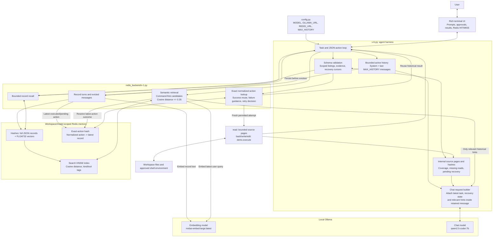

# v-6: bounded context with Redis memory

[v-6.py](v-6.py) is a standalone interactive Ollama agent built on v-5.
It moves older conversation messages into Redis instead of keeping the full
transcript in the model context. [v-5.py](v-5.py) is unchanged.

## Current configuration and startup

Current defaults in [config.py](config.py):

| Setting | Value | Purpose |
| --- | --- | --- |
| `MODEL` | `qwen2.5-coder:7b` | JSON-action chat model |
| `OLLAMA_URL` | `http://127.0.0.1:11434` | Chat and embedding endpoint |
| `REDIS_URL` | `redis://localhost:6380/0` | Redis connection configuration |
| `MAX_HISTORY` | `3` | Maximum conversation messages per chat request |

The [Redis backend](redis_backend/v-1.py) uses the installed
`mxbai-embed-large:latest` embedding model by default.
`ZENO_EMBED_MODEL` can select another installed embedding model.
The backend verifies model availability and derives vector dimensions from an
embedding response. It does not download models.

Requires Redis with Search / Query Engine vector support. See
[the Ubuntu WSL startup guide](redis_backend/README-v-1.md).
From the repository root, after starting Redis and Ollama:

```powershell
python -m pip install -r .\local_tests\redis_backend\requirements.txt
python .\local_tests\v-6.py --workspace .\local_tests
```

Enter tasks interactively. `/bye`, end of input, or Ctrl+C exits.
Commands and writes/edits require approval and run with your account
permissions; this is not a sandbox.

## Architecture diagram



**Two different memory paths:** semantic search supplies hints about how prior
tasks were performed; exact lookup decides whether an identical proposed action
already has a recorded outcome. Similarity alone never suppresses execution.

## Sequence diagram: one user task

```mermaid
sequenceDiagram
    actor User
    participant UI as Rich TUI
    participant Agent as v-6 harness
    participant Memory as Redis backend
    participant Embed as Ollama embeddings
    participant Redis as Redis Search + hashes
    participant LLM as Ollama chat model
    participant Tools as Reader / demo.execute

    Agent->>Agent: Startup checks model, embedding dimensions, and Redis index
    Agent->>Redis: Upgrade exact-action metadata without replacing saved vectors

    User->>UI: Submit task
    UI->>Agent: Prompt + retained history + source state
    Agent->>Memory: Record user turn
    Memory->>Embed: Embed record
    Embed-->>Memory: FLOAT32-compatible vector
    Memory->>Redis: Save full record + vector

    loop Until finish, failure, or request limit
        opt More than MAX_HISTORY conversation messages
            Agent->>Memory: Archive oldest message role/content
            Memory->>Embed: Embed archived message
            Embed-->>Memory: Vector
            Memory->>Redis: Save conversation record
            Redis-->>Memory: Write completed
            Memory-->>Agent: Archive completed
            Agent->>Agent: Remove archived message from active history
            Agent->>UI: Context moved to Redis
        end

        Agent->>Agent: Check source hashes and build action schema
        Agent->>Memory: Retrieve hints for latest user query
        Memory->>Embed: Embed search query
        Embed-->>Memory: Query vector
        Memory->>Redis: KNN search across commands, tools, and conversation/context
        Redis-->>Memory: Candidate records and cosine distances
        Memory->>Redis: Resolve linked latest action outcomes
        Redis-->>Memory: Latest records
        Memory->>Memory: Filter distance <= 0.35 and deduplicate actions
        Memory-->>Agent: Relevant hints, or empty list
        Agent->>UI: Redis semantic search HIT/MISS

        Agent->>Agent: Enforce history limit after new harness feedback
        Agent->>Agent: Attach task/state and optional hints inside retained message
        Agent->>Agent: Keep one system message and at most MAX_HISTORY conversation messages
        Agent->>Agent: Do not add a hint message or call LLM compaction
        Agent->>Agent: Drop lower-priority hints if byte budget exceeded
        Agent->>UI: Model context: message and attached-hint counts
        Agent->>LLM: Bounded messages + JSON action schema
        LLM-->>Agent: One JSON action
        Agent->>Memory: Record raw model response
        Memory->>Embed: Embed record
        Embed-->>Memory: Vector
        Memory->>Redis: Save model record
        Agent->>Agent: Validate action, scope, evidence, and recovery requirements

        alt Invalid action
            Agent->>Memory: Record correction
            Agent->>UI: Correction with nothing executed
            Agent->>Agent: Append correction to active history
        else Valid finish
            Agent->>UI: Answer + checked evidence/coverage if applicable
        else Valid tool action
            Agent->>Memory: Look up exact normalized action
            Memory->>Redis: Latest action record
            Redis-->>Memory: Record or miss
            Memory-->>Agent: Previous outcome
            Agent->>UI: Redis exact-action lookup HIT/MISS

            alt User declined this action in current task
                Agent->>Agent: Block execution, including explicit retries
            else Unchanged failed attempt without retry_reason
                Agent->>Agent: Block with original error and correction guidance
            else Unchanged exact hit without retry_reason
                Agent->>Agent: Reuse historical result with no execution now
            else Miss, changed source, or permitted explicit retry
                alt read
                    Agent->>Tools: Read bounded source page
                    Tools-->>Agent: Text, hashes, EOF, and next cursor
                else recall
                    Agent->>Memory: Page through saved record by ID
                    Memory->>Redis: Fetch full record
                    Redis-->>Memory: Record body
                    Memory-->>Agent: Bounded historical text + next character
                else bash, write, or edit
                    Agent->>Memory: Save pending action with unknown outcome
                    Memory->>Redis: Record + latest-action pointer
                    Agent->>Tools: Propose command/change
                    Tools->>UI: Request approval
                    UI->>User: Show command/change and ask approval
                    User-->>UI: Approve or decline
                    UI-->>Tools: Decision
                    Tools-->>Agent: Result, error, or cancellation
                end
            end

            Agent->>Memory: Save full tool result and update exact pointer only for fresh attempt
            Memory->>Embed: Embed result preview text
            Embed-->>Memory: Vector
            Memory->>Redis: Save full record + vector
            Agent->>UI: Tool result / historical reuse / failure
            Agent->>Agent: Append bounded feedback and update recovery state
        end
    end

    Agent->>Memory: Record task answer/error
    Agent->>Memory: Archive excess final history
    Agent-->>UI: Return bounded history for next task
```



The diagram groups repeated record-writing internals for readability. Redis
writes for corrections, pending actions and task outcomes also embed their
record text. Errors are surfaced instead of silently falling back to an
in-memory transcript.

## Context and memory contracts

### What the chat model receives

- One system message containing runtime facts and tool rules.
- At most `MAX_HISTORY` recent conversation messages; currently three.
- The latest user task and current recovery/coverage state attached within
  one retained message, so evicting the original prompt does not lose the goal.
- Relevant Redis hints attached within that same message, only when search
  candidates pass the relevance filter and fit the request budget.
- A JSON action schema, including checked source-evidence choices and any
  mandatory next-read cursor.

There is no full-transcript replay and no model-generated history summary.
`MAX_HISTORY` counts conversation messages, not tokens or tool calls.
Embedding API calls use text input, not chat history, so this message limit
applies to `/api/chat`, not `/api/embed`.

### What stays outside the model context

- Full Redis records: user/model turns, tool results, corrections, task outcomes
  and evicted message role/content.
- Exact normalized action keys and latest action pointers.
- Verified source pages, hashes, coverage and task bookkeeping held by the
  Python harness. These are not all replayed as source text to the model.

Read pages retain v-5's bounded pagination and source verification.
`recall(record_id, from_character)` retrieves historical records in pages;
recalled source alone is not valid checked evidence for current source claims.

### Retrieval policy

Each model turn searches Redis using the latest user request:

1. Up to three shell-command candidates.
2. One other tool candidate, excluding shell commands and recall.
3. One conversation/context candidate, which can include archived messages
   from the current task.
4. Filter candidates using cosine distance `<= 0.35`.
5. Resolve linked actions to their latest known outcome and remove duplicates.

The threshold is an initial heuristic, not a guarantee of relevance. Successful
commands provide method hints; failed commands provide error/correction hints.
Different paths or arguments can reuse the method without becoming an exact
cache hit. Redis is searched every model turn, even when no hints qualify.

### Exact lookup and retries

| Previous state | Default behavior |
| --- | --- |
| No exact record | Execute the requested action with applicable approval |
| Successful unchanged exact action | Return historical result, clearly marked not executed now |
| Failed unchanged action | Block with original error; correct arguments or choose another method |
| Changed source file | Read current source rather than reuse old pages |
| Pending/unknown action | Report historical unknown outcome; do not assume success or repeat silently |
| Nonempty `retry_reason` | Permit a fresh identical attempt, with normal approvals |
| User declined action in current task | Block retries in that task |

Three repeated cached/declined requests without an allowed retry stop the task.
For directory listings, a simple root-directory command cannot satisfy a task
asking for another directory. The scope guard is intentionally not a general
shell parser.

## Observability

| Terminal panel | Meaning |
| --- | --- |
| `Context moved to Redis` | Messages were persisted and removed from active history |
| `Redis semantic search: HIT/MISS` | Relevant historical hints were found or none qualified |
| `Model context` | Actual retained message count and attached hint count |
| `Redis exact-action lookup: HIT/MISS` | The proposed exact action has a previous record or does not |
| `Retrieved exact action` | A historical result was reused without fresh execution |
| `Source cache invalidated` | Source changed or became unavailable; old evidence was removed |

Semantic HIT panels describe retrieved hints; the model-context panel reports
how many survived the final request-budget check.

## Persistence, safety and validation status

Memory is scoped by resolved workspace and embedding-model digest/dimensions.
Changing workspace or embedding model selects a different namespace.
Existing v-6 exact-action records are upgraded with searchable tool metadata
without regenerating their vectors. Older records may lack a separately stored
original task.

There is no automatic expiry. Persistence across Redis/server restarts depends
on Redis AOF/RDB and volume configuration. Records can contain source code,
commands and full tool output: protect Redis access and backups. Embedding input
may be truncated while full record text remains available through recall.

Historical command output is not proof of current state. Request fresh execution
explicitly when needed. A message-count limit does not guarantee a token limit;
oversized retained messages/state fail explicitly if removing hints cannot make
the request fit. Archival embeddings and Redis searches add work, so smaller
chat context does not necessarily mean lower latency.

These diagrams describe the current implementation from source inspection.
No tests, Pylance, diagram-rendering checks or live v-6 execution were performed
for this documentation update.
