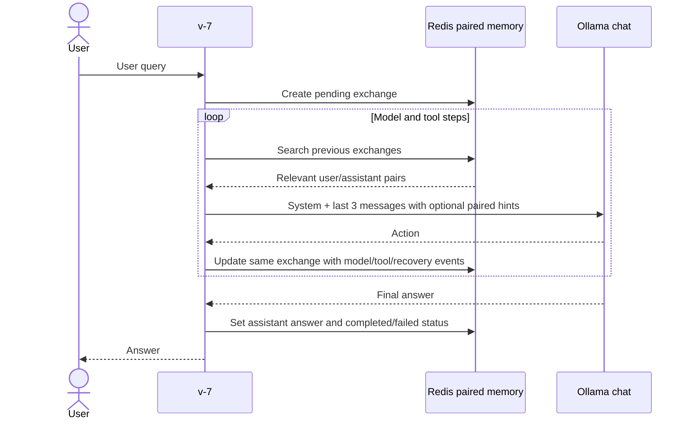

# v-7: paired exchange memory

[v-7.py](v-7.py) keeps each user query and its resulting assistant answer in
one Redis exchange record using [redis_backend/v-2.py](redis_backend/v-2.py).
[v-6.py](v-6.py) has only a docstring update; its executable code and
[v-1 backend](redis_backend/v-1.py) are unchanged.

## Run

Use the same Redis Search, Ollama and optional Python dependency setup as
[v-6](README-v-6.md). From the repository root:

```powershell
python .\local_tests\v-7.py --workspace .\local_tests
```

Chat uses `MODEL` from [config.py](config.py); embeddings default to the
installed `mxbai-embed-large:latest`. `MAX_HISTORY = 3` still means one system
message plus at most three conversation messages per chat request.
Relevant hints are attached inside a retained message, not added as messages.
Commands and changes still require approval.

## Stored exchange and retrieval

A short conversation produces one searchable record:

```json
{
  "user": "My name is Prashant",
  "assistant": "Hi Prashant!",
  "status": "completed",
  "error": null,
  "tool_steps": [],
  "events": []
}
```

Actual records also include IDs, timestamps and model/recovery events.
A later relevant query retrieves **both user and assistant together**, not
two independent hits.



- The stable record ID is the user request's turn ID. The same Redis hash and
  vector are updated after each recorded event.
- Ordered tool calls/results belong to the exchange. Corrections, model
  responses and evicted conversation messages are retained within it.
- Pending exchanges keep `assistant: null`; an interrupted process does not
  manufacture a completed answer.
- Semantic search excludes the currently running exchange and returns up to
  three previous exchanges passing cosine distance `<= 0.35`.
- Hints contain both sides of short exchanges in full. Each side of a long
  exchange is limited to 700 characters; up to three recent tool/pending-action
  previews are included. Partial hints are marked, and `recall` pages through
  the full exchange by its ID.
- Separate, non-search-indexed step hashes retain latest exact-action
  pointers. They preserve duplicate prevention, retry decisions and source
  page restoration without becoming separate semantic hits.
- Terminal search panels show paired user/assistant previews and exchange
  status. Existing exact-action HIT/MISS and context-count panels remain.

## Version boundaries and limitations

v-7 uses a `zeno:v7:` namespace and a separate Search index. Existing v-6
records are not deleted or automatically migrated into pairs. v-2 reuses
v-1's connection/embedding and exact-lookup helpers; its base initialization
also performs the existing v-6 index setup before selecting v-7 storage.

Full tool output stays in Redis, but hints are bounded. Embedding text uses
bounded user/answer/method excerpts and may be truncated by the embedding
model. Relevance and summarization quality remain heuristic.

Records are updated incrementally, not only at the final answer. A failed Redis
write is surfaced; there is no silent fallback. The last acknowledged update
is what survives an interruption. Redis AOF/RDB and volume settings determine
server-restart durability. Protect records and backups containing source or
personal conversation data.

No tests, Pylance, lint, or live script execution were run for this change.
